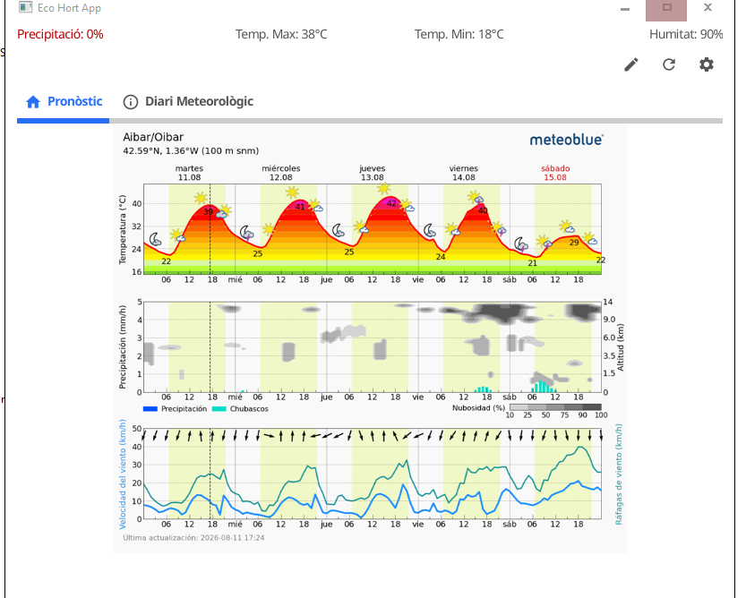

# 🌱 EcoHortApp

**EcoHortApp** es una aplicación de escritorio y web desarrollada en **Go** y **Fyne**. Su objetivo es proporcionar información meteorológica en tiempo real y predicciones oficiales de la **AEMET** (Agencia Estatal de Meteorología) para la gestión y optimización de huertos ecológicos.

---

## 🔑 Configuración de la API Key de AEMET

Para obtener datos meteorológicos de la AEMET, es necesaria una clave gratuita que se puede solicitar en [AEMET OpenData](https://aemet.es).

La clave se puede configurar de dos formas:

1. **Desde la interfaz gráfica (Usuarios finales):**
   * Abre la aplicación y haz clic en **Preferencias (⚙️)**.
   * Entra en la pestaña **Mode PRO**, pega tu clave y haz clic en **Guardar**.

2. **Mediante archivo `.env` (Desarrolladores / Entorno local):**
   * Copia o renombra el archivo `.env.example` a `.env`.
   * Añade tu clave en la variable: `AEMET_API_KEY=tu_clave_aqui`.

---

## 🚀 Características principales

* 🌤️ **Monitoreo meteorológico:** Consulta de datos climáticos y pronósticos detallados.
* 📍 **Conversión geodésica y parseo inteligente:** Soporte integral para 4 formatos de coordenadas de AEMET (DMS, sexagesimales compactas, decimales directos y métricas UTM Huso 30N) estandarizadas automáticamente a WGS84 para mapas y meteogramas mediante algoritmos puros.
* ⚙️ **Sistema de Ajustes Dual (Pestañas):**
  * 📍 **Per Municipi:** Búsqueda rápida y sincronizada por **Nombre** o **Código INE/AEMET**.
  * ⚡ **Mode PRO:** Filtro jerárquico masivo con selección en cascada por **Comunidades Autónomas y Provincias**.
* ⚡ **Consultas concurrentes:** Descargas asíncronas optimizadas mediante Goroutines y semáforos de red.
* 💾 **Persistencia local en SQLite:** 
  * Almacenamiento desacoplado mediante el patrón **Repository** sin necesidad de servidor externo.
  * Operaciones CRUD completas para el historial manual de registros meteorológicos.
  * Sistema de **caché local en disco** (`municipios_cache.json`) para la lista de maestros de AEMET, reduciendo la latencia de inicio y garantizando protección contra límites de tasa de peticiones (HTTP 429).
* 🎨 **Interfaz adaptable:** Diseñada con la librería gráfica Fyne (compatible con Windows, Linux, macOS y WebAssembly).

---

## 🗄️ Arquitectura de Base de Datos (SQLite)

El almacenamiento persistente está gestionado por la implementación `SQLiteRepository` (`internal/repository/sqlite_repo.go`). La inicialización automatizada de esquemas se ejecuta a través del método `Migrate()`:

### 1. Tabla `registres` (Histórico Manual / CRUD)
Permite gestionar las lecturas introducidas manualmente por el usuario:
- `id` (INTEGER PRIMARY KEY AUTOINCREMENT)
- `data_registre` (INTEGER NOT NULL - Unix Timestamp)
- `precipitacio` (INTEGER NOT NULL)
- `temp_maxima` (INTEGER NOT NULL)
- `temp_minima` (INTEGER NOT NULL)
- `humitat` (INTEGER NOT NULL)

### 2. Tabla `prediccions` (Estructura para Mode PRO)
Almacena las predicciones meteorológicas diarias de AEMET:
- `codi_ine` (TEXT NOT NULL) - Código INE del municipio.
- `data_prediccio` (INTEGER NOT NULL - Unix Timestamp)
- `prob_precipitacio` (INTEGER NOT NULL DEFAULT 0)
- `temp_maxima` (INTEGER NOT NULL DEFAULT 0)
- `temp_minima` (INTEGER NOT NULL DEFAULT 0)
- `humitat_relativa` (INTEGER NOT NULL DEFAULT 0)
- `created_at` (INTEGER NOT NULL - Unix Timestamp)
- **PRIMARY KEY (`codi_ine`, `data_prediccio`)**

---

## 🏗️ Estructura del Proyecto (Arquitectura Limpia)

El código ha sido refactorizado y desacoplado en carpetas con responsabilidades únicas aisladas:

### 📌 Orquestador y Punto de Entrada
* **`cmd/app/main.go`**: Punto de arranque minimalista del ejecutable binario. Orquesta la inicialización de los loggers de infraestructura, levanta la base de datos de SQLite y despliega la ventana máster de Fyne.

### 🍎 Capa de Dominio (Núcleo Puro)
* **`internal/domain/domain.go`**: Contiene la definición centralizada de estructuras de datos compartidas (`Config`, `UserConfig`, `Diaria`, `Municipio`, etc.) ordenadas estrictamente por su alineamiento de bytes para optimizar la memoria RAM. Define la interfaz abstracta `Repository`.

### 🗄️ Capa de Infraestructura y Repositorios (`internal/repository/`)
* **`db_sqlite.go`**: Implementación en SQLite3 del patrón Repository con soporte CRUD completo e inicialización de migraciones protegidas individualmente por `id`.
* **`config_repo.go`**: Gestión de persistencia física en disco para las opciones del huerto (`config.json`).
* **`logger_repo.go`**: Centralización técnica de los manejadores de registros direccionados al archivo `app.log`.
* **`clima-text.go`**: Motor técnico de red que ejecuta el parseo de los arrays JSON de AEMET (`AutoGenerated` / `PreUrl`) y computa la función `GetClimaText` de Fyne.
* **`aemet_client.go` / `aemet_maestros.go`**: Controlador de llamadas HTTP concurrentes y administración de la caché local de municipios.
* **`mode_pro_state.go`**: Gestor de estado que automatiza la persistencia de las provincias e INE seleccionados en el Modo PRO.

### 🧠 Capa de Lógica de Negocio y Casos de Uso (`internal/usecase/geo/`)
* **`utm.go`**: Fórmulas matemáticas puras para la conversión de coordenadas cilíndricas UTM (Huso 30N España) a coordenadas geográficas.
* **`coord_parser.go`**: Analizador de cadenas encargado de discernir y validar de forma nativa los formatos de coordenadas DMS, compactas o decimales de AEMET.

### 🎨 Capa de Interfaz de Usuario Gráfica (`internal/ui/`)
* **`toolbar.go` / `add_registres_dialog.go`**: Construcción de menús superiores y formularios emergentes interactivos con validación de tipos.
* **`pestanya_municipi.go` / `pestanya_mode_pro.go`**: Layouts modulares para la selección y filtrado geográfico por CCAA.
* **`mode_pro_resum.go`**: Pantalla informativa que gestiona y renderiza el desglose detallado de descargas por regiones.
* **`pronostic_pestanya.go` / `registre_pestanya.go`**: Módulos visuales adaptativos encargados de pintar la rejilla CRUD de históricos y descargar asíncronamente los gráficos climáticos de Meteoblue.
* **`banners.go` / `errors.go`**: Renderizado cromático dinámico de alertas meteorológicas e interfaz amigable de control de errores.
* **`bundled.go`**: Almacenamiento binario estático de imágenes incrustadas dentro del ejecutable para evitar archivos externos perdidos.

---

## 🔄 Flujo de Datos y Conexión entre Ficheros

### 1. Flujo de Consulta Meteorológica Individual (Pestaña Municipi)

[internal/ui/pestanya_municipi.go] 
       │ (1. El usuario selecciona municipio y captura código INE)
       ▼
[internal/repository/clima-text.go] ──► (2. GetPreUrl construye endpoint dinámico)
       │                                       │
       ▼                                       ▼
[API OpenData AEMET] ◄─────────────────────────┘ (3. Petición HTTP asíncrona)
       │
       │ (4. Devuelve respuesta JSON cruda mapeada en arrays)
       ▼
[internal/domain/domain.go] ──► (5. Descodifica en la estructura AutoGenerated / Diaria)
       │
       ▼
[internal/repository/clima-text.go] ──► (6. GetClimaText traduce a cadenas de texto de Fyne)
       │
       ▼
[cmd/app/main.go] ──► (7. Renderiza los textos actualizados en el contenedor máster)


2. Flujo de Descarga Masiva (Mode PRO)

1. internal/ui/pestanya_mode_pro.go: El usuario marca en las casillas las CCAA o Provincias que desea descargar.
2. internal/repository/mode_pro_state.go: Captura los eventos de los checks e inyecta o remueve los códigos INE de la lista de municipios activos.
3. internal/ui/mode_pro_resum.go: Recupera el estado final, calcula en O(1) la volumetría por CCAA y renderiza el diálogo modal flotante detallado en la interfaz de Fyne.

3. Flujo de Gestión Manual (CRUD Registres)

1. internal/ui/add_registres_dialog.go: El usuario introduce o edita datos de clima en el formulario modal con validadores en tiempo real.
2. internal/ui/registre_pestanya.go: Captura las entradas validadas y delega el flujo de guardado.
3. internal/repository/sqlite_repo.go: Traduce el dominio a sentencias SQL (INSERT, UPDATE, DELETE) con cláusulas where id = ? controladas.
4. Tabla registres (SQLite): Persiste de forma permanente los cambios en el disco duro.
5. internal/ui/registre_pestanya.go: Fuerza el refresco visual de la rejilla tabular mediante app.RegistresTable.Refresh().

6. Flujo de Consultas de Alertas y Banner Meteorológico (AEMET CAP)

7. internal/ui/pronostic_pestanya.go (ActualitzarGraficPronostic): Lee el código INE del municipio activo desde el dominio.
8. internal/repository/clima-text.go (ObtenirAlertaActual): Realiza la doble petición al endpoint CAP de avisos de AEMET.
9. internal/ui/banners.go (CrearBannerAlerta): Intercepta los strings resultantes (rojo, naranja, amarillo) y dibuja una tarjeta de canvas coloreada con márgenes proporcionales sobre el climagrama de Meteoblue.

🛠️ Requisitos e Instalación

1. Tener instalado Go (versión 1.23.7 o superior).
2. Clona o descarga este repositorio en tu equipo.
3. Configura la clave de API de AEMET (mediante .env o en la interfaz gráfica).

## 🛠️ Requisitos e Instalación

1. **Tener instalado Go** (versión 1.27.3 o superior para mitigación de fallos de seguridad críticos).
2. Clona o descarga este repositorio en tu equipo.
3. Configura la clave de API de AEMET (mediante `.env` o en la interfaz gráfica).

---

## 💻 Ejecución

Ejecuta la aplicación desde la terminal con:

```bash
go run ./cmd/app
```



---

## 📦 Compilación

Para generar el ejecutable binario para distribución:

```bash
# Windows (sin consola de comandos al abrir apuntando al cmd de la app)
go build -ldflags="-H windowsgui" -o EcoHortApp.exe ./cmd/app

# Linux / macOS
go build -o EcoHortApp ./cmd/app
```
